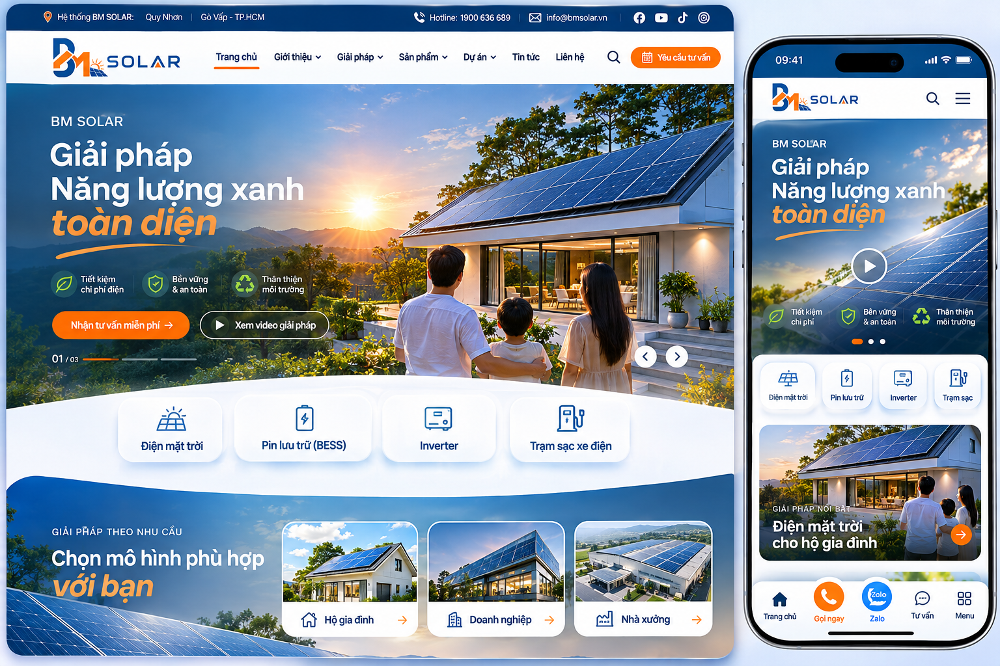

# 02 — Ánh xạ Giao diện UI Tham chiếu → CMS Data Contract (Golang)



## 1. Bảng ánh xạ Thành phần Giao diện (UI Components Inventory)

| Khu vực trên UI | Thực thể CMS / Trường dữ liệu trong Go | Endpoint API tương ứng | Hành vi trên thiết bị di động (Mobile) |
|---|---|---|---|
| **Top utility bar** (Thanh tiện ích trên cùng) | `SiteSettings.UtilityBar` + `[]Branch` | `GET /api/v1/public/site-shell` | Tự động rút gọn hoặc hiển thị dropdown chọn chi nhánh; không làm vỡ giao diện. |
| **Logo thương hiệu** | `BrandSettings.LogoMediaID`, `LogoAlt` | `GET /api/v1/public/site-shell` | Hiển thị responsive logo phù hợp màn hình nhỏ. |
| **Menu điều hướng chính** | `NavigationTree`, các `NavigationItem` phân cấp | `GET /api/v1/public/site-shell` | Chuyển thành Menu Drawer / Bottom Sheet có thể đóng mở dễ dàng. |
| **Hotline, Email, Icon MXH** | `ContactChannel` theo chi nhánh hoặc toàn hệ thống | `GET /api/v1/public/site-shell`, `/branches/:id/channels` | Tối ưu hiển thị các kênh quan trọng nhất, giữ trong tầm với ngón tay cái. |
| **Hero Slider (Ảnh/Video)** | `Page.Sections["hero"]` với `DesktopMediaID`, `MobileMediaID`, `Overlay`, `CTA` | `GET /api/v1/public/pages/home` | Art direction: dùng ảnh tỉ lệ 4:5 hoặc dọc, không tự động phát video nặng trên 4G/5G. |
| **Khối Lợi ích / Điểm nhấn** | Block `featureHighlights` | `GET /api/v1/public/pages/home` | 2–3 icon trên một hàng hoặc cuộn ngang mượt mà (swipe). |
| **Danh mục sản phẩm nhanh** | Block `categoryShowcase` trỏ tới `ProductCategory` | `GET /api/v1/public/pages/home` | Cuộn ngang dạng snap-scroll, hiển thị rõ ràng từng thẻ. |
| **Khối Nhu cầu** (Gia đình/Doanh nghiệp/Nhà xưởng) | Block `audienceShowcase` trỏ tới `Audience` + Media | `GET /api/v1/public/pages/home` | Thẻ hình ảnh đại diện nổi bật với tỉ lệ crop phù hợp. |
| **Dự án tiêu biểu** | Block `projectGallery` (Query động hoặc gán thủ công) | `GET /api/v1/public/pages/home` | 1 dự án chính lớn kèm danh sách cuộn phía dưới. |
| **Tin tức & Sự kiện** | Block `articleFeed` | `GET /api/v1/public/pages/home` | Thẻ tin tức lấy hình ảnh làm trọng tâm kèm ngày đăng. |
| **Form liên hệ & tư vấn** | Block `leadForm`, `contactPanel` | `GET /api/v1/public/pages/home`, `POST /public/leads` | Form ngắn gọn (Tên, Số điện thoại, Nhu cầu), nút bấm CTA to rõ. |
| **Nút Gọi / Zalo nổi trên Desktop** | `ContactChannel` theo chi nhánh đang chọn | `GET /api/v1/public/branches/:id/channels` | Nút cố định góc dưới bên phải màn hình. |
| **Thanh công cụ cố định đáy Mobile** | `MobileActionBarConfig.Items` | `GET /api/v1/public/site-shell` | Cố định đáy: Trang chủ, Sản phẩm, Nút Gọi (`tel:`), Nút Zalo, Menu. Có Safe-Area padding. |
| **Chân trang (Footer)** | `FooterConfig` (Nhóm liên kết, chi nhánh, pháp lý) | `GET /api/v1/public/site-shell` | Dạng accordion thu gọn từng nhóm trên mobile. |

---

## 2. Content Block Registry trong Golang (Strict Discriminated Structs)

Trong Golang, toàn bộ các khối nội dung được định nghĩa chặt chẽ, không dùng kiểu generic map tùy tiện. Khi lưu trữ hoặc serialize, mỗi block mang định danh `Type` rõ ràng.

### Khung Block tổng quát trong Go:
```go
type BlockType string

const (
    BlockHeroCarousel      BlockType = "heroCarousel"
    BlockFeatureHighlights BlockType = "featureHighlights"
    BlockCategoryShowcase  BlockType = "categoryShowcase"
    BlockAudienceShowcase  BlockType = "audienceShowcase"
    BlockProjectGallery    BlockType = "projectGallery"
    BlockProductGrid       BlockType = "productGrid"
    BlockArticleFeed       BlockType = "articleFeed"
    BlockContactPanel      BlockType = "contactPanel"
    BlockLeadForm          BlockType = "leadForm"
    BlockRichText          BlockType = "richText"
    BlockFAQ               BlockType = "faq"
    BlockStats             BlockType = "stats"
)

type ContentBlock struct {
    ID        string          `json:"id" validate:"required"`
    Type      BlockType       `json:"type" validate:"required"`
    Version   int             `json:"version" validate:"required,min=1"`
    Enabled   bool            `json:"enabled"`
    SortOrder int             `json:"sortOrder"`
    Data      json.RawMessage `json:"data" validate:"required"` // Parsed thành struct cụ thể theo Type
}
```

### Các Struct Payload tương ứng từng Block:
1. **HeroCarouselData:**
   ```go
   type HeroSlide struct {
       Title          string     `json:"title" validate:"required"`
       Subtitle       string     `json:"subtitle,omitempty"`
       DesktopMediaID string     `json:"desktopMediaId" validate:"required"`
       MobileMediaID  string     `json:"mobileMediaId,omitempty"`
       OverlayOpacity float64    `json:"overlayOpacity" validate:"min=0,max=1"`
       CTA            *CtaTarget `json:"cta,omitempty"`
   }
   type HeroCarouselData struct {
       Slides []HeroSlide `json:"slides" validate:"required,min=1,max=6"`
   }
   ```
2. **FeatureHighlightsData:**
   ```go
   type FeatureItem struct {
       IconToken   string `json:"iconToken" validate:"required"`
       Title       string `json:"title" validate:"required"`
       Description string `json:"description,omitempty"`
   }
   type FeatureHighlightsData struct {
       Items []FeatureItem `json:"items" validate:"required,min=1,max=6"`
   }
   ```
3. **CategoryShowcaseData & AudienceShowcaseData:**
   ```go
   type CategoryShowcaseData struct {
       CategoryIDs []string `json:"categoryIds" validate:"required,min=1"`
       DisplayMode string   `json:"displayMode" validate:"oneof=grid carousel"`
   }
   type AudienceShowcaseData struct {
       AudienceCodes []string `json:"audienceCodes" validate:"required,min=1"`
   }
   ```

---

## 3. Phân định Trách nhiệm (Ownership Distinction)
- **Frontend sở hữu:** Component layout, animation, CSS variables, breakpoint responsive, touch targets (tối thiểu 44x44px), và xử lý fallback an toàn khi gặp block chưa hỗ trợ.
- **Backend CMS sở hữu:** Thứ tự block, trạng thái kích hoạt, nội dung văn bản, URL media, liên kết CTA, thông số kỹ thuật, cấu hình màu sắc thương hiệu (Theme Tokens), dữ liệu SEO.
- **Quy tắc an toàn:** CMS không bao giờ lưu trữ hoặc gửi HTML/JavaScript thô độc hại lên Frontend. Mọi text đều được escape, mọi link đều được validate theo danh sách allowlist protocol (`http`, `https`, `tel`, `mailto`).

---

## 4. Cơ chế Phân giải Kênh Liên hệ theo Chi nhánh (Branch Contact Resolution)
- Khi khách hàng đang chọn chi nhánh `go-vap`:
  1. Backend tìm kiếm `ContactChannel` chủ động (active) của chi nhánh `go-vap`.
  2. Nếu chi nhánh có số hotline riêng, API trả về số đó (được chuẩn hóa theo định dạng quốc tế E.164 cho link `tel:`).
  3. Nếu chi nhánh chưa cấu hình hoặc bị vô hiệu hóa, hệ thống tự động fallback về kênh liên hệ mặc định toàn hệ thống (`branch_id IS NULL`).
  4. Nếu toàn hệ thống không có kênh liên hệ nào hợp lệ, API đánh dấu `enabled: false` để Frontend ẩn nút một cách an toàn mà không bị crash.
- Tuyệt đối không sinh số điện thoại hoặc tài khoản Zalo giả định trong mã nguồn.
